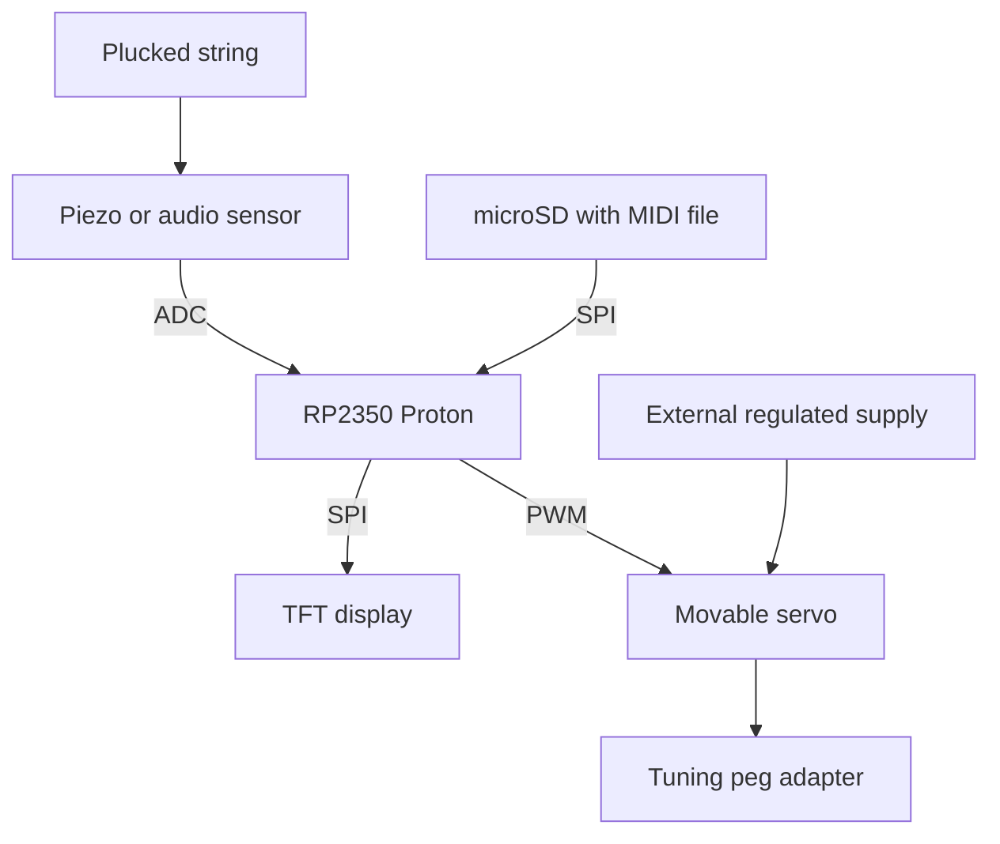

# Guitar Tunas

**An automatic guitar tuner built on the Purdue Proton**

ECE 36200 · Fall 2026 · Team 57  
**Project status** In development · **Iris proposal** Approved

Guitar Tunas is an automatic guitar tuner built around Purdue ECE 362's RP2350 Proton board. The device measures the pitch of a plucked guitar string, compares it with the desired note from a MIDI file on a microSD card, and uses a PWM-controlled servo to turn the guitar's tuning peg. A TFT LCD provides feedback during tuning.

**Mechanical plan.** We will use one removable servo/peg adapter, moving it manually from one guitar tuning knob to the next. Only one string is tuned at a time. This is an update from the original Iris parts list, which proposed six servos. This README is our planning and progress tracker. Hardware selection, pin assignments, algorithms, and checkboxes will be updated as the design is tested.

## Contents

- [Project objectives](#project-objectives)
- [How it works](#how-it-works)
- [System architecture](#system-architecture)
- [Shopping list and bill of materials](#shopping-list-and-bill-of-materials)
- [Guitar target frequencies](#guitar-target-frequencies)
- [Work plan and checkoffs](#work-plan-and-checkoffs)
- [Integration and testing](#integration-and-testing)
- [Team responsibilities](#team-responsibilities)
- [Design decisions and open questions](#design-decisions-and-open-questions)
- [Project deliverables](#project-deliverables)
- [References](#references)

## Project objectives

These are the four objectives from our staff-approved Iris proposal: 

| Objective | Peripheral | Function |
| --- | --- | --- |
| 1 | PWM | Drive a servo to rotate a guitar tuning peg. |
| 2 | ADC | Sample the guitar sensor to estimate pitch. |
| 3 | SPI | Read target notes from a MIDI file on microSD. |
| 4 | SPI | Show the detected note, graphics, and tuning feedback on a TFT LCD. |

> **Course requirement to confirm.** The introductory course slides describe a requirement for four unique peripherals, but our Iris proposal was approved with SPI listed twice. We will ask the TA/lab coordinator whether the approved objectives are sufficient as written. Confirm whether the two SPI objectives satisfy the course requirement before revising the scope.

The RP2350 will be the only computer controlling the device. A laptop can prepare MIDI files for the microSD card. The Proton controls tuning at runtime.

## How it works

1. Create a MIDI file containing the desired tuning notes and copy it onto the SD card.
2. Select the string/target note to tune (user interaction method still to be finalized).
3. Place the single servo adapter over the corresponding tuning peg.
4. Pluck the string.
5. The sensor produces an analog signal; the RP2350 samples it with the ADC.
6. Firmware estimates the string's fundamental frequency and compares it with the target.
7. If the pitch is too low (flat) or too high (sharp), the RP2350 commands a small servo adjustment through PWM.
8. Stop the motor, pluck/measure again, and repeat until within the chosen tolerance.
9. Display **IN TUNE** on the TFT LCD, then move the adapter to the next peg.

> **Servo safety.** Use short, bounded adjustments with a reliable stop command. Stop and remeasure after every adjustment to reduce the risk of overtightening or breaking a string.

## System architecture



The servo supply and Proton share a ground.

**Pitch estimation.** Guitar signals contain harmonics, so detecting the highest-amplitude frequency alone may produce the wrong note. We will evaluate a suitable fundamental-frequency estimation method (e.g., autocorrelation or a validated alternative) and handle low-signal/noisy readings.

**SPI wiring.** The SD reader and TFT may share SPI clock/data lines if supported by the hardware, using separate chip-select pins. Exact wiring is TBD.

## Shopping list and bill of materials

### Parts to order or fabricate

| Item | Qty. | Model or notes | Next step |
| --- | --- | --- | --- |
| Continuous-rotation micro servo | 1 | Adafruit FS90R, DigiKey 1528-1501-ND. Turns the tuning peg. | Verify torque and availability |
| Piezo sensing element | 2 | Same Sky CEB-2704-L100. One active sensor and one spare. | Order |
| Regulated servo supply | 1 | Match the final servo's voltage and current requirements. | Select and order |
| ADC input conditioning | As needed | Bias network, resistors, capacitors, and input protection. | Design and source |
| Wiring and connectors | As needed | Breadboard leads, servo connector, and shared ground. | Check lab kit |
| Servo-to-peg adapter | 1 | Printed or fabricated coupler that grips the tuning peg. | Design and fabricate |
| Handheld servo housing | 1 | Printed or fabricated grip to keep the servo body from rotating. | Design and fabricate |
| microSD card | 1 | Compatible FAT-formatted card for the MIDI file. | Check kit or obtain |

Proposed purchasing links:

- [CEB-2704-L100 piezo on DigiKey](https://www.digikey.com/en/products/result?keywords=CEB-2704-L100)
- [FS90R servo on DigiKey](https://www.digikey.com/en/products/result?keywords=1528-1501-ND)

**Before ordering.** Verify the selected servo's torque is sufficient to turn the actual guitar's tuning pegs. A small continuous-rotation servo may need a different gear ratio or a higher-torque replacement. The current parts list calls for one servo. 

### Lab kit and team supplies

| Item | Qty. | Notes |
| --- | --- | --- |
| RP2350 Proton development board | 1 | Main controller |
| TFT LCD | 1 | Verify SPI display module |
| microSD reader | 1 | Verify module and voltage requirements |
| Breadboard | 1 | Prototype wiring |
| Debug probe, cables, and computer | As needed | Firmware development and debugging |
| Guitar | 1 | Test instrument |

Check the kit inventory before ordering. 

### Shopping checkoffs

- [ ] Check ECE kit inventory for display, SD interface, wires, and microSD card.
- [ ] Verify exact servo specification and test expected torque/rotation.
- [ ] Order one servo (not six).
- [ ] Order piezo element(s).
- [ ] Select safe servo power supply.
- [ ] Design and obtain ADC conditioning/protection parts.
- [ ] Measure tuning peg and servo shaft; make adapter.
- [ ] Confirm all ordered components have arrived and work.

## Guitar target frequencies

Standard guitar tuning with A4 = 440 Hz.

| String | Note | MIDI note | Frequency (Hz) |
| --- | --- | --- | --- |
| 6 (lowest) | E2 | 40 | 82.41 |
| 5 | A2 | 45 | 110.00 |
| 4 | D3 | 50 | 146.83 |
| 3 | G3 | 55 | 196.00 |
| 2 | B3 | 59 | 246.94 |
| 1 (highest) | E4 | 64 | 329.63 |

MIDI note numbers can be converted using:

```text
frequency_hz = 440.0 * 2^((midi_note - 69) / 12)
```

A tuning tolerance expressed in cents is useful across strings:

```text
cents_error = 1200 * log2(measured_frequency / target_frequency)
```

- Negative: flat (frequency too low).
- Positive: sharp (frequency too high).
- Near zero: in tune. The exact acceptance tolerance (for example, ±5 cents) must be chosen and validated by the team.

## Work plan and checkoffs

Check a box only after it has been tested. Unchecked means not yet verified, not necessarily that no work has started.

### 0. Planning and setup

- [ ] Form team and submit Iris proposal.
- [ ] Receive approval as Team 57 — Guitar Tunas.
- [ ] Create GitHub repository.
- [ ] Agree to use one movable servo, tuning one string at a time.
- [ ] Confirm final part models and circuit design.
- [ ] Confirm accepted peripheral objectives with TA.
- [ ] Decide how user selects string/target note.
- [ ] Record final RP2350 pin assignments and wiring diagram.

### 1. ADC — sensor and pitch detection

- [ ] Build piezo mounting and safe analog input circuit.
- [ ] Verify ADC input voltage range and protection.
- [ ] Read ADC samples using RP2350 firmware.
- [ ] Establish stable sample rate and sample buffer.
- [ ] Detect when the string is plucked / signal is strong enough.
- [ ] Estimate frequency from samples.
- [ ] Verify each of the six standard-string frequencies with a known reference tuner.
- [ ] Handle noisy audio, harmonics, and missing signal.
- [ ] Output stable measured frequency to the rest of the program.

### 2. PWM — servo and peg adapter

- [ ] Wire servo with external power and shared ground.
- [ ] Produce PWM signal from RP2350.
- [ ] Find reliable clockwise, counterclockwise, and stop commands.
- [ ] Test safe, short rotation bursts.
- [ ] Confirm servo can turn the guitar's tuning peg.
- [ ] Fabricate and test removable tuning-peg adapter.
- [ ] Verify tightening/loosening direction on the actual guitar.
- [ ] Add motor timeout, step limit, and emergency stop method.
- [ ] Demonstrate servo control independently of the sensor.

### 3. SPI — SD card and MIDI

- [ ] Wire and initialize SD card interface.
- [ ] Read a test file from the card.
- [ ] Prepare a valid MIDI file with tuning notes.
- [ ] Parse required MIDI header/track/note events (document supported format).
- [ ] Convert MIDI note numbers to frequencies.
- [ ] Map selected guitar string to target note.
- [ ] Handle missing card, invalid file, and unsupported MIDI content.
- [ ] Pass desired frequency to the tuning controller.

### 4. SPI — TFT LCD

- [ ] Wire and initialize TFT LCD.
- [ ] Display text and graphics.
- [ ] Show selected string/target note.
- [ ] Show measured frequency (Hz).
- [ ] Show FLAT / SHARP / IN TUNE status.
- [ ] Show a useful tuning meter or visual indicator.
- [ ] Show errors (no signal, missing card, motor stop, etc.).
- [ ] Test display updates alongside ADC sampling and SPI SD access.

### 5. Closed-loop tuning and integration

- [ ] Combine measured frequency and target-note modules.
- [ ] Implement frequency/error comparison.
- [ ] Set a tolerance for successful tuning.
- [ ] Decide small, safe servo correction duration based on error.
- [ ] Stop servo between adjustments and remeasure.
- [ ] Ignore unreliable frequency readings.
- [ ] Prevent uncontrolled rotation when readings are absent or wrong.
- [ ] Demonstrate complete one-string automatic tuning.
- [ ] Move same servo to another tuning peg and repeat.
- [ ] Integrate SD-driven targets and live TFT feedback.
- [ ] Test all six strings one at a time.

### 6. Documentation and demonstration

- [ ] Add circuit schematic / wiring diagram.
- [ ] Document the final bill of materials and pin map.
- [ ] Document how to build, flash, and run the firmware.
- [ ] Add photos of hardware and adapter.
- [ ] Record successful tuning demo.
- [ ] Prepare project explanation and testing results.
- [ ] Complete course checkoff / demonstration.

## Integration and testing

| Test | Pass condition | Status |
| --- | --- | --- |
| Sensor voltage | ADC input stays within its safe range. | Pending |
| Pitch accuracy | Measured pitch agrees with a reference tuner within the chosen tolerance. | Pending |
| Servo direction | The servo tightens, loosens, and stops reliably. | Pending |
| Peg adapter | The adapter fits and can be moved between pegs without damage. | Pending |
| SD and MIDI | Firmware reads the intended target notes. | Pending |
| Display | The TFT shows the correct note, frequency, and status. | Pending |
| Automatic correction | Each adjustment moves the pitch toward the target. | Pending |
| Stop condition | The servo stops within the chosen tolerance. | Pending |
| Fault handling | The servo stops on invalid readings, timeout, or user abort. | Pending |
| Full demo | The same servo tunes multiple strings in sequence. | Pending |

**First milestone.** Make the RP2350 measure the pitch of a string correctly; independently test whether the servo can physically turn a peg. These two tests reduce the biggest project risks.

## Team responsibilities

Proposed workstreams. Member assignments are pending.

| Workstream | Main tasks | Owner |
| --- | --- | --- |
| Servo and mechanics | PWM, motor testing, peg adapter, safety limits | TBD |
| Sensor and pitch | Input conditioning, ADC sampling, pitch estimation | TBD |
| SD and MIDI | SPI file access, MIDI parsing, target-note selection | TBD |
| Display and integration | TFT interface, graphics, end-to-end testing | TBD |

Everyone should help with code reviews, integration, debugging, and final demonstrations.

## Design decisions and open questions

### Confirmed

- Main controller: RP2350 Proton.
- Firmware-based sensing and motor control.
- Desired tuning comes from MIDI file on SD card.
- TFT displays detected pitch/tuning feedback.
- One servo is moved manually between knobs.
- Only one string is tuned at a time. 

### To validate
- Piezo vs microphone: The Iris description uses “microphone,” while the related-work description specifies a piezo vibration sensor. The listed CEB-2704-L100 is a piezo element; final sensor implementation must be tested.
- Servo torque: Confirm the FS90R can turn the particular guitar's tuning pegs. Replace with a stronger servo if needed.
- Frequency algorithm: Choose a method that handles the guitar's harmonics and noise.
- MIDI file format: Decide exact supported subset (e.g., single-track MIDI with specific note events) to keep parsing manageable.
- String selection: Decide whether selection uses a physical button or existing input hardware.
- Four unique peripherals: Clarify the approved SPI/SPI objectives with the TA.
- Safety: Set a maximum number/duration of servo adjustments, a no-signal stop rule, and a way to abort immediately.

## Project deliverables

- Working RP2350-based hardware prototype
- Functional ADC pitch sensing, PWM servo control, SPI SD/MIDI reading, and SPI TFT display
- One removable servo-to-peg adapter
- Safe closed-loop tuning demonstration
- Source code and wiring documentation
- Testing results and final course demo/checkoff

### Course timeline

 The course introduction identifies **Nov 30–Dec 4, 2026** as the project checkoff/demo period. A PCB is optional extra credit, separate from the main prototype; the uploaded PCB FAQ gives a **Nov 6, 2026 at 5 PM** design submission deadline. If we pursue PCB extra credit, check the latest instructor instructions before submission.

## References

- ECE 362 Guitar Tunas GitHub repository
- Team 57 approved project proposal (Iris, Fall 2026)
- ECE 362 course project introduction (Fall 2026)
- Elektor — DIY Guitar Tuner
- SparkFun — Piezo Vibration Sensor Hookup Guide
- Component datasheets should be added once the final sensor, servo, and power supply are confirmed.
